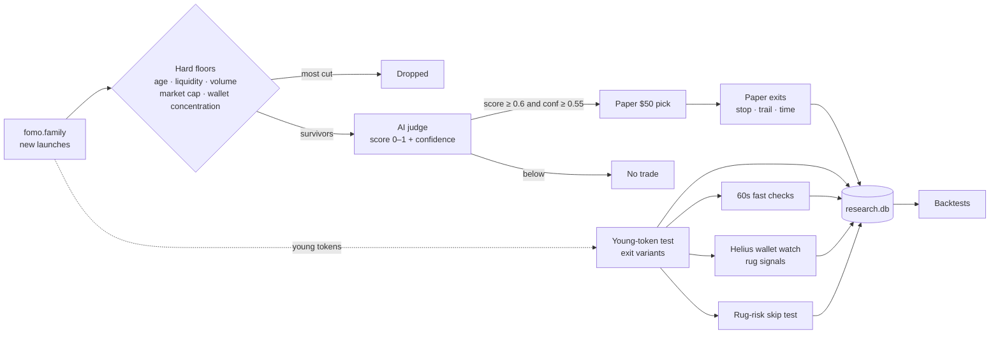
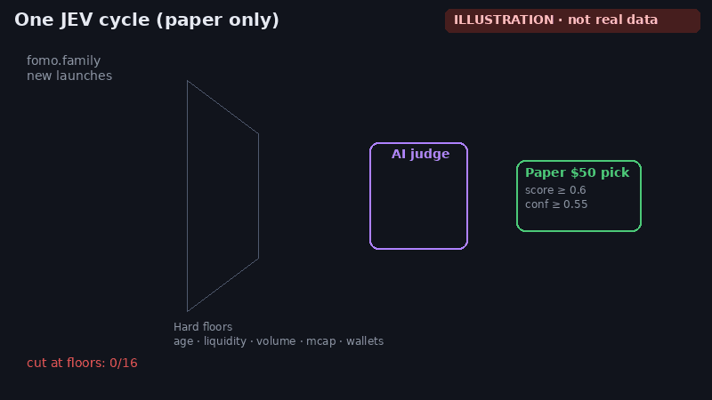
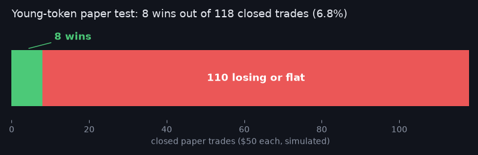
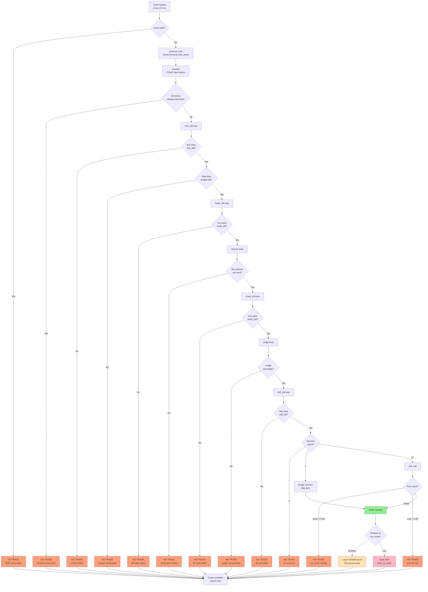
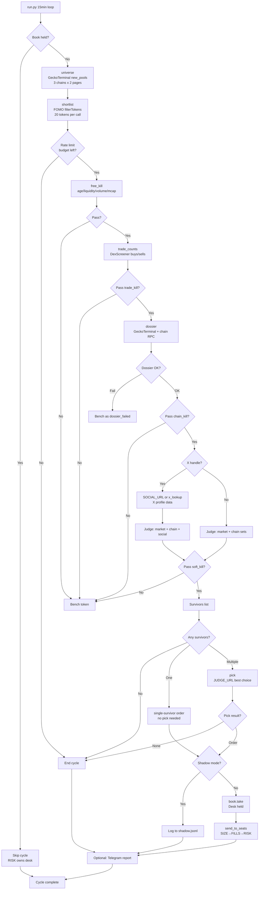

# Jev Desk

## What JEV is and why

JEV is a shadow desk. Shadow means paper-only: it watches the market and writes down
what it would have done, and it never places a real order. It follows brand-new
memecoins — joke or internet-culture tokens that often appear and vanish in a day —
as they launch on fomo.family, across Solana, BSC, Base, and Robinhood Chain.

About every fifteen minutes it runs one cycle, a single pass through the new names.
It collects the latest tokens, then applies hard safety floors: automatic cuts for
age, liquidity (cash sitting in the trading pool), volume (how much has actually
changed hands), market cap (the token's total implied value), and wallet
concentration (how much of the supply a few addresses hold). Tokens that survive
those floors go to an AI judge, which scores each one from 0 to 1. A score of 0.6
or higher, with judge confidence of at least 0.55, becomes a simulated $50 pick: a pretend fifty-dollar trade, logged as if
it had been placed.

Beside that loop sit a few side experiments, all still on paper. The young-token
test follows very new coins and tries exit variants — different rules for when to
sell. A faster version of the same entries checks prices every sixty seconds.
Helius wallet-watch looks for rug signals: sudden insider dumps that collapse the
price. A rug-avoidance entry test scores the same young_trail names at entry
(sniper share, bundled launch buys, the creator's prior rugs, fresh wallets among
top holders) and records what P&L would have been if those names had been skipped;
it never blocks a pick or the judge. And research.db is a local file that records
every sighting and outcome so a rule can be backtested, meaning replayed against
past data, before anyone treats it as real.



*How one cycle flows. Every step is paper only: no real orders are placed.*



*Illustration only, not real data: most launches are cut at the floors, a few are scored, one becomes a paper trade, and it exits when an early rug signal fires.*

The hoped-for benefit is simple. Catch the few launches that run early, get out
before the many that rug, and prove any rule on paper before risking real money.

After about a week of paper data, no rule has been profitable out-of-sample — that
is, on data it was not tuned against. Most young-token paper trades lose money (8 wins in 118 closed trades so far). The
Helius sell signal is the most promising lead so far, but the sample is small.
Live trading stays off until a rule shows realized profit on paper: gains after
those pretend trades are closed.



*Young-token paper test so far: 8 wins in 118 closed $50 paper trades.*

The live picture is at `/ops` on 127.0.0.1:8080.

A memecoin launch desk built from @savipww's "Megabrain (Jev) & Six Grok Bots" setup guide
(x.com/savipww/status/2102720919185617314). Code fetches, Jev judges, code decides.

```
0. UNIVERSE  GeckoTerminal new_pools, 3 chains          -> fresh launches
1. LIST      FOMO filterTokens, 20 per call             -> hundreds, one batch
2. FREE CUT  age, liquidity, volume, mcap. No network   -> tens
3. TRADE CUT DexScreener buys and sells, one per token  -> a handful
4. DOSSIER   GeckoTerminal info + chain RPC + X         -> three per cycle
5. JUDGE     market + chain + social per token          -> scored shortlist
6. PICK      one choice over the shortlist              -> one token, or none
```

Then the order goes to the Grok Bot seats: SIZE -> FILLS -> RISK, with CHIEF logging.

## Read this first

This is the guide author's setup, not a strategy. Every threshold in `thresholds.py` is
theirs, tuned to their launches, bank and risk tolerance. The desk trades brand-new
memecoin launches, which is about as high-risk as trading gets, and the guide itself
carries a referral link and unverifiable performance claims. A week of paper data so far
shows no profitable entry rule. Stay in shadow, keep collecting, and only consider
`--live` after a rule actually pays. Nothing here is financial advice.

## Project state

The funnel runs on the live Mac under two launchd jobs (desk + ops). Default mode is
still shadow: scan, judge, pick, and log — no `book.take`, no live orders unless
`CONFIRM_LIVE=yes` and `--live`. Paper ledgers (`young_trail` and its variants, the 60s
fast ledger, and the Helius rug-signal ledger) sit beside the desk and do not change
thresholds, pick, filter, or trade logic.

**Current finding:** a week of paper data shows no profitable entry rule yet. Treat
`thresholds.py` as the guide author's starting point, not a validated edge. Keep
collecting research.db / outcomes / young_trail rows; do not promote a rule from one
quiet week.

The pytest suite is offline and keyless (`python -m pytest -q`). CI runs it on every
push and pull request across Python 3.10 through 3.14. Dependencies are pinned.

Still true: every number in `thresholds.py` is the guide author's rather than yours.

## Files

| file | seat | what it does |
|---|---|---|
| `judge.py` | JUDGE | FastAPI service. Holds the only TypeSafe key. Answers typed questions, decides nothing. |
| `server.py` | JUDGE / OPS | `judge.py` plus `/book/*`, the `/ops` page, and the read-only `/ops/*` JSON. |
| `ops.html` | OPS | Desk page. No external URLs. Loads `/ops/summary`, briefing, paper ledgers, research. |
| `ops_summary.py` | OPS | Cached `/ops/summary` aggregate. `launchctl list` only (never kickstart). |
| `questions.py` | — | Every question the desk can ask. The one file you will reread. |
| `collect.py` | SCAN, VET | GeckoTerminal universe, FOMO shortlist, DexScreener trade counts, dossier, Solana RPC. |
| `fomo_api.py` | SCAN | FOMO client. Pulls the Privy bearer out of the FomoDesk Chrome profile over CDP. |
| `thresholds.py` | — | Every number. Retune here and nowhere else. |
| `filter.py` | — | The kills, in cost order: free -> trade -> chain -> soft. |
| `pick.py` | CHIEF | One Choice over the survivors plus the `worth_trading_at_all` gate. |
| `book.py` | — | SQLite: one open position, reasoned bench. RISK is the only caller of `release()`. |
| `main.py` | SHIFT | `run_once` and the 15-minute loop. `shadow=True` by default. |
| `desk.py` | — | Bank, X read, shadow log, Telegram, seat handoff. |
| `run.py` | — | Entrypoint. `--once`, `--live`, `--mock-judge`, `--bench`. |
| `x_lookup.py` | SOCIAL | Keyless fxtwitter lookup when `SOCIAL_URL` is unset. Capped per cycle. |
| `coinalyze.py` | OPS | Log-only market mood. Never feeds filter, pick, or thresholds. |
| `outcomes.py` | research | 6h path drain into `outcomes.db`. CoinGecko Demo / free GeckoTerminal. |
| `gt_api.py` | research | Onchain helper: free GT, Demo, Pro. Demo monthly cap 9000. |
| `research.py` | research | `research.db` snapshots, 60s marks, labels, CLI, backfill. |
| `cycle_history.py` | OPS | Cycle store + morning briefing (`/ops/briefing`). |
| `young_trail.py` | paper | $50 paper ledger on free-passers younger than 60 min. |
| `young_trail_variants.py` | paper | Exit-rule replay on the same per-cycle marks. |
| `young_trail_fast.py` | paper | Same entries, baseline + `tp_50`, evaluated on 60s Dex marks. |
| `young_trail_helius.py` | paper | Solana rug-signal paper exits from budgeted Helius RPC. |
| `young_trail_rugrisk.py` | paper | Entry-time rug-risk features + skip-rule counterfactuals. No gating. |
| `young_trail_signals.py` | paper | RugCheck / DexScreener boosts / Birdeye skip-rule counterfactuals. No gating. |
| `judge_client.py` | bots | Six lines. The only place a bot touches the network for a judgement. |
| `mock_judge.py` | — | Keyless stand-in for Jev so the funnel can be tested. Never trade against it. |
| `prompts/` | bots | Paste-ready prompts: HANDOFF, SOCIAL, CHIEF, SIZE, FILLS, RISK. |
| `tests/` | — | `python -m pytest -q`. No network, no keys. |
| `requirements.in` | — | Direct dependencies. Edit this one. |
| `requirements.txt` | — | Compiled lock, fully pinned. Install this one. Never hand-edit. |

## Setup

```bash
python3 -m venv .venv && source .venv/bin/activate      # python 3.10+
pip install -r requirements.txt
cp .env.example .env                                     # fill it in, then: set -a; source .env; set +a
python -m pytest -q                                      # full suite, no keys needed
```

Always run tools as `python -m <tool>` rather than the bare executable. A bare `pytest`
can resolve to a pytest outside this venv — a pipx or Homebrew install in `~/.local/bin`
is the usual culprit, and zsh keeps the pre-`activate` path in its command hash table, so
activating the venv does not always dislodge it. That foreign interpreter has its own
site-packages and fails on the first project import:

```
ModuleNotFoundError: No module named 'typesafe_sdk'
```

The package is installed; the wrong Python is reading it. `python -m pytest` uses the
active interpreter by definition and cannot pick the wrong one. If you want the bare name
back, run `rehash` after `source .venv/bin/activate`, and confirm with
`python -c "import sys; print(sys.executable)"`.

### Dependencies

`requirements.txt` is a compiled lock: every package pinned, transitive ones included,
with markers so one file covers Python 3.10 through 3.14 on Linux and mac. Do not edit it
by hand. Add or move a dependency in `requirements.in`, then recompile:

```bash
uv pip compile requirements.in -o requirements.txt --universal --python-version 3.10
```

Compiling at 3.10 rather than your local version is the point: `pytest` needs `tomli` and
`exceptiongroup` below 3.11, and a lock frozen on a newer interpreter simply omits them.
CI recompiles and diffs, so a `requirements.in` edit without a recompile fails the build.

### 1. The judge (one machine, holds the key)

```bash
export TYPESAFE_API_KEY="ts-..."                         # console.typesafe.ai -> Keys
export DESK_SECRET="$(openssl rand -hex 24)"             # what the bots get. NOT the key.
uvicorn server:app --host 0.0.0.0 --port 8080
cloudflared tunnel --url http://localhost:8080           # bots run in xAI's cloud, not on your box
```

Prove the key works before anything else:

```bash
curl -X POST https://api.typesafe.ai/v1/systemone \
  -H "Authorization: Bearer $TYPESAFE_API_KEY" -H "Content-Type: application/json" \
  -d '{"state":"payouts have been failing for 3 days","model":"jev-latest",
       "questions":{"urgent":{"type":"noul","instructions":"This conveys urgency"}}}'
```

Then prove the link **from a bot's own terminal**, not your laptop:

```bash
curl -X POST $JUDGE_URL -H "Authorization: Bearer $DESK_SECRET" -H "Content-Type: application/json" \
  -d '{"question_set":"market","state":{"ticker":"TEST","age_minutes":42,"holder_count":310,
       "change":{"5m":0.04,"1h":0.22,"24h":0.61},"buys_h1":540,"sells_h1":120,
       "liquidity_usd":48000,"mcap_usd":310000,"volume_h24":610000,"intended_ticket_usd":900}}'
```

`answers.shape.choice` must be one of your options, probabilities must sum to ~1, and
`model` must be a version string, not an alias. If any of the three is off, stop there.

### 2. FomoDesk Chrome token flow

FOMO has no public API. The desk uses your own logged-in session.

Use a **dedicated Chrome profile** (FomoDesk) started with remote debugging, and leave a
`fomo.family` tab open in **that** window — not your everyday Chrome:

```bash
# mac — dedicated user-data-dir, CDP on 9222
open -na "Google Chrome" --args --remote-debugging-port=9222 \
  --user-data-dir="$HOME/FomoDesk"
```

Stay logged in there. Each cycle `Fomo.token()` connects to `CDP_URL` (default
`http://127.0.0.1:9222`), finds the `fomo.family` tab, and reads the Privy access token
from `localStorage` (`privy:token` or `privy:access_token`). The token dies roughly
hourly; the desk refreshes it on its own. Never log or print the bearer.

`/ops` has **Fix FOMO Login** (`POST /api/fomo_activate` with header
`X-Ops-Action: activate-fomo`). That brings the FomoDesk tab to the front, or opens
`fomo.family` in that CDP Chrome if no tab exists. Log in in **that** window.

If you would rather not expose CDP, set `FOMO_BEARER` yourself. It still expires in about
an hour.

The FOMO `filterTokens` envelope is undocumented. `fomo_api._row` maps the field names
the guide lists and tolerates a list or a dict envelope. If `--once` logs "malformed row"
for every token, print one raw row and adjust `_row`.

### 3. Launchd services

On the Mac the two long-running processes are launchd agents (labels from
`ops_summary.py`). Plists live on the operator machine under
`~/Library/LaunchAgents/`, not in this repo.

| label | process | what it does |
|---|---|---|
| `com.robbrown.jevdesk.desk` | `run.py` | 15-minute shift: universe, FOMO, kills, judge, paper ledgers, research snapshots |
| `com.robbrown.jevdesk.ops` | `uvicorn server:app` | Judge, `/book/*`, `/ops` page and JSON, `/api/state` |

`/ops` and `/api` handlers are plain `def` (Starlette threadpool) so SQLite/file work cannot stall `POST /judge` on the event loop. `outcomes.db` is WAL + `synchronous=NORMAL`. Ops readers open `mode=ro` with a short busy timeout and fall back to cached/partial JSON.

To serve the judge from its own process (optional; plists live on the Mac, not in this repo), point the desk at that port and leave `/ops` on 8080:

```bash
# extra launchd wrapper / one-shot
uvicorn judge:app --host 127.0.0.1 --port 8081
export JUDGE_URL="http://127.0.0.1:8081/judge"   # desk + bots; tunnel 8081 if seats are remote
# keep com.robbrown.jevdesk.ops on 8080 for /ops /book /api
```

`GET /ops/summary` runs `launchctl list` only. It never kickstarts or unloads anything.

```bash
# status
launchctl list | grep jevdesk

# restart one or both (gui domain, current user)
launchctl kickstart -k "gui/$(id -u)/com.robbrown.jevdesk.desk"
launchctl kickstart -k "gui/$(id -u)/com.robbrown.jevdesk.ops"
```

If kickstart is unavailable, bootout then bootstrap the plist:

```bash
UID=$(id -u)
launchctl bootout "gui/$UID/com.robbrown.jevdesk.desk"
launchctl bootstrap "gui/$UID" "$HOME/Library/LaunchAgents/com.robbrown.jevdesk.desk.plist"
```

Start both from the same repo root (or set `DESK_DB` / `DESK_OUTBOX` to absolute paths)
so the book and outbox stay shared. After a restart, wait one cycle for
`outbox/state.json` and confirm `/ops` shows both PIDs.

### 4. The shift

```bash
export JUDGE_URL="https://<tunnel>/judge" DESK_SECRET="..." BANK_USD=1000
python run.py --once           # one cycle, shadow. Read the log and outbox/shadow.jsonl
python run.py                  # shadow, every 15 min. Leave it a week.
python run.py --bench          # what is sitting out and why
```

Shadow mode does everything except take the book and hand the order over. Each would-be
trade is one row in `outbox/shadow.jsonl` with the ticker, every answer with the model id,
and the rejection counters. Fill in `your_call` by hand and read only the rows where you
disagree. That is where your thresholds come from.

```bash
CONFIRM_LIVE=yes python run.py --live      # after the shadow week, not before
```

### 5. The Grok Bot seats

Paste `prompts/HANDOFF.txt` above the prompt of every seat that makes a judgement
(SCAN, VET, SOCIAL, CHIEF), then the seat's own file. SIZE, FILLS and RISK get no judge
call and no key. Record one judge call by hand in front of Grok Bot and save it as a
skill; skills are shared across every bot on the desk.

Two integration points on the Python side, both optional:

- `SOCIAL_URL`: an endpoint your SOCIAL bot serves. `POST {"x_handle": "..."}` returns
  the X block from `prompts/SOCIAL.txt`. Unset: in-desk `x_lookup` (fxtwitter). Failure
  still applies `NO_SOCIAL_CUT` (0.60).
- `SEATS_WEBHOOK_URL`: CHIEF's inbox. A finished order is POSTed there. Unset means it is
  written to `outbox/orders/` for you to hand over.

RISK frees the book with `POST $JUDGE_URL/../book/release` (same `DESK_SECRET`). Until
that call the desk does not scan, so a close nobody reported is a desk that stopped.

## Testing without a key

```bash
python -m pytest -q                              # no network, no key
DESK_SECRET=x JUDGE_MOCK=1 uvicorn server:app    # judge with synthetic answers
python run.py --once --mock-judge                # funnel end to end, still needs FOMO + GeckoTerminal
```

`python -m pytest`, not `pytest` — see Setup for why.

## Budget

**Desk GeckoTerminal (free):** about 10 calls/min historically; the live desk paces closer
to 5/min so outcomes can share the pipe. Six list fresh pools (3 chains × 2 pages), a
few left for dossiers. `universe(pages=1)` frees slots if 429s persist.

**Outcomes CoinGecko Demo:** set `COINGECKO_API_KEY` (name only — never log the value)
and `COINGECKO_PLAN=demo`. Hard cap **9000 calls/month**, split across remaining days.
In-window spacing is 2s. When the month or today's share is gone, outcomes fall back to
free GeckoTerminal. Demo is outcomes/backtest only, not the live universe scan.

**Outcomes free GeckoTerminal:** ~7s spacing in the bulk window; daytime trickle
(`OUTCOMES_TRICKLE_SEC`, default 20s) outside `OUTCOMES_WINDOW` (default 01:00–06:00
local).

**Helius / Solana RPC:** `SOLANA_RPC_URL` (name only — never log the value). Desk
dossiers and the paper Helius ledger share it. The paper ledger caps calls per 60s tick
and per UTC day (defaults 12 / 3000). Errors go through `safe_err`.

**Jev:** $0.042/Mtok in, output free: roughly ten calls of ~1,400 tokens per cycle, 96
cycles a day, about six cents a day.

## Failure handling

| what | do |
|---|---|
| 429 GeckoTerminal | back off a full minute, do not retry in place. Persisting: `pages=1`. |
| 429 DexScreener | lower `DEX_BUDGET` in `main.py`. |
| 429 / 529 Jev | the SDK retries with backoff on its own. |
| 422 Jev | your question is malformed. The cycle stops (`JudgeDown`). Never retry. |
| dossier throws | that token is benched as `dossier_failed`. Not a pass. |
| judge unreachable | the cycle stands down. No guessing. |
| FOMO 401/403 | bearer expired; refreshed from Chrome automatically. |

## Deviations from the guide

Everything the guide pastes is here as written, plus the glue it references but does not
include: `fomo_api.py`, `desk.py`, `run.py`, `server.py` (book endpoints for RISK),
`mock_judge.py` and tests. Small fixes to the guide's code: `chain_kill` treats Base like
BSC for the honeypot fact, `trade_counts` and `dossier` tolerate missing fields instead
of raising, a 422 from the judge stops the cycle instead of being swallowed, `--live`
needs `CONFIRM_LIVE=yes`, and the single-survivor path applies the same `size_factor`
cuts the pick path does.

## External connections

The desk connects to these external services:

**FOMO prod-api.fomo.family filterTokens** — required for shortlist stage
- Purpose: Fetches token metadata (mcap, liquidity, volume, holders, price changes) from FOMO's curated launches
- Connection: `FOMO_BEARER` environment variable OR Chrome CDP at `CDP_URL` (default 127.0.0.1:9222)
- Required for: Shadow mode and live trading
- Failure: Cycle stops. 401/403 triggers automatic refresh from Chrome

**FomoDesk Chrome CDP / Privy session** — required only if no `FOMO_BEARER`
- Purpose: Reads the Privy bearer from the dedicated FomoDesk profile's `fomo.family` tab
- Connection: `CDP_URL` (default `http://127.0.0.1:9222`)
- Required for: FOMO access when `FOMO_BEARER` is not set
- Failure: FOMO becomes unreachable; `/ops` **Fix FOMO Login** activates or opens the tab
- Never log the bearer or the RPC URL

**GeckoTerminal api.geckoterminal.com** — required
- Purpose: Universe scan (new_pools) and detailed dossiers (token info, pool data, social handles)
- Connection: HTTPS, no auth, user-agent header
- Required for: Every cycle (universe) and per-token dossier
- Failure: 429 backs off one minute. Persistent 429 means reduce `pages=1` in universe call

**DexScreener api.dexscreener.com** — required for trade counts in shortlist stage
- Purpose: Provides buy/sell transaction counts for filtering
- Connection: HTTPS, no auth
- Required for: trade_kill stage
- Failure: 429 means lower `DEX_BUDGET` in main.py

**Solana RPC via `SOLANA_RPC_URL`** — conditional
- Purpose: Top-wallet concentration for Solana dossiers; paper Helius rug-signal checks
- Connection: HTTPS JSON-RPC. Set the env var name only; never log or print the value
- Required for: Solana dossiers (not BSC/Base/Robinhood). Paper Helius ledger is optional
- Failure: Dossier throws, token benched as `dossier_failed`. Paper Helius fails open

**CoinGecko onchain (`COINGECKO_API_KEY`)** — optional, outcomes only on Demo
- Purpose: 6h OHLCV for `outcomes.db` (same payload shape as GeckoTerminal)
- Connection: Demo or Pro header. Never log the key
- Failure: Fall back to free GeckoTerminal. Demo stops the key at 9000 calls/month

**Coinalyze (`COINALYZE_API_KEY`)** — optional, log-only
- Purpose: Market-mood tag on `/ops` and the briefing
- Connection: Never log the key. Missing key skips the fetch; the cycle continues
- Failure: One INFO line; never feeds filter, pick, or thresholds

**TypeSafe judge via local uvicorn** — required
- Purpose: AI judgement calls for market/chain/social question sets
- Connection: `JUDGE_URL` with `Authorization: Bearer $DESK_SECRET`, backed by `TYPESAFE_API_KEY`
- Required for: Every token that passes free/trade/chain kills
- Failure: Unreachable judge stops the cycle. 422 (malformed question) stops cycle permanently

**Local judge/book FastAPI :8080** — required
- Purpose: Serves `/judge` for bots plus `/book/held` and `/book/release` for RISK seat
- Connection: Bots hit `JUDGE_URL` with `DESK_SECRET` bearer token
- Required for: All judgement calls and book coordination
- Failure: Judge unreachable stops cycle. Missing `/book/release` call freezes desk

**Cloudflare Tunnel** — optional, for remote seats
- Purpose: Exposes local :8080 judge/book server to xAI cloud where Grok Bots run
- Connection: `cloudflared tunnel --url http://localhost:8080`
- Required for: Remote Grok Bot seats (not needed if bots run on same machine)
- Failure: Bots cannot reach judge

**SOCIAL_URL / in-desk X lookup** — optional bot, else keyless fxtwitter
- Purpose: X profile block for the social question set
- Connection: `POST {"x_handle": "..."}` if `SOCIAL_URL` is set; otherwise `x_lookup.py`
- Failure: Unset or error means `NO_SOCIAL_CUT` (0.60 size factor)

**SEATS_WEBHOOK_URL** — optional live seat handoff
- Purpose: CHIEF's inbox for finished orders
- Connection: POST order JSON to webhook
- Required for: Automated order handoff in `--live` mode
- Failure: Unset means orders written to `outbox/orders/` for manual handoff

**Telegram** — optional notifications
- Purpose: Per-cycle status report (trade or no-trade summary)
- Connection: `TELEGRAM_BOT_TOKEN` and `TELEGRAM_CHAT_ID`
- Required for: Operator notifications
- Failure: Silently skipped if not configured

Environment variable **names** (never commit or log values): `BANK_USD`, `DESK_SECRET`,
`JUDGE_URL`, `TYPESAFE_API_KEY`, `FOMO_BEARER`, `CDP_URL`, `SOCIAL_URL`,
`SEATS_WEBHOOK_URL`, `TELEGRAM_BOT_TOKEN`, `TELEGRAM_CHAT_ID`, `DESK_DB`, `DESK_OUTBOX`,
`JUDGE_MOCK`, `CONFIRM_LIVE`, `SOLANA_RPC_URL`, `COINALYZE_API_KEY`, `COINGECKO_API_KEY`,
`COINGECKO_PLAN`, `OUTCOMES_WINDOW`, `OUTCOMES_TRICKLE_SEC`, `X_LOOKUPS_PER_CYCLE`,
`X_LOOKUP_BUDGET_SEC`.

## Ops panel

`GET /ops` serves `ops.html` (no external URLs, no secrets in payloads). The page is the
redesigned desk: health, young_trail curve, paper ledgers, rugs-vs-runners, a read-only
SQL box, outcomes drain, API budget, Coinalyze mood, morning briefing, and the local
FOMO activate control. `GET /ops/summary` is cached 30s; every section fails open via
`safe_err`. Bind the ops process to localhost.

| endpoint | what |
|---|---|
| `GET /ops` | Desk HTML |
| `GET /ops/summary` | Read-only aggregate (30s cache): launchd PIDs, cycle health, judge-hi, outcomes drain, budget, Coinalyze, young_trail curve |
| `GET /ops/briefing` | Last-24h briefing + 7-day trends |
| `GET /ops/briefing?compact=1` | `date_local`, `generated_at_iso`, markdown, morning only (small) |
| `GET /ops/young_trail` | Paper young_trail ledger (simulated, no live orders) |
| `GET /ops/young_trail_variants` | Exit-variant ranking on the same per-cycle marks |
| `GET /ops/young_trail_fast` | 60s-mark ledger vs per-cycle, same entries |
| `GET /ops/young_trail_helius` | Helius rug-signal paper ledger vs fast vs per-cycle |
| `GET /ops/young_trail_rugrisk` | Paper rug-risk skip-rule counterfactuals (does not gate entries) |
| `GET /ops/young_trail_signals` | Paper RugCheck / boosts / Birdeye skip-rule counterfactuals (does not gate entries) |
| `GET /ops/research/query?sql=` | Read-only `SELECT` on `research.db` (limit 500) |
| `GET /ops/research/report?kind=` | Canned `rugs` / `runners` / `features` |
| `GET /ops/backtest` | Latest weekly signal-backtest JSON |
| `GET /api/state` | `outbox/state.json` |
| `GET /api/shadow_ledger` | Hypothetical shadow PnL |
| `GET /api/fomo_status` | Bearer present / CDP reachable — never the token |
| `POST /api/fomo_activate` | Bring the FomoDesk `fomo.family` tab forward |

Empty states: if `/ops` says no `state.json` yet, wait for a cycle. The page never
invents demo tokens.

## young_trail paper test

Paper only. A token that free-passes with `age_minutes < 60` is bought once (first tid)
at a $50 ticket. Marks use DexScreener, never GeckoTerminal. Does not change
`young_trail` live rules from the cycle's point of view, and does not change
`thresholds.py`, `pick.py`, `filter.py`, `questions.py`, or `collect.py`. Same experiment
end as the live week: **2026-10-20 11:59 PM ET**.

**Baseline exits** (whichever first): hard stop −30% from entry, 30% trail from peak
(price ≤ peak × 0.7), time exit at 6h.

**Per-cycle variants** (`young_trail_variants`, same marks, ~15 min cadence):

| id | lever |
|---|---|
| `baseline` | SL −30, trail 30%, 6h |
| `tp_50` / `tp_100` | take-profit +50% / +100% |
| `half_50_trail` | sell half at +50%, then trail 30% |
| `trail_20` / `trail_40` | tighter / wider trail |
| `sl_20` | tighter stop −20% |
| `time_1h` / `time_2h` / `time_3h` | earlier time exits |
| `be_after_30` | breakeven stop after +30% |

**`young_trail_fast`:** copies the same tids and entry prices from deploy onward. Evaluates
baseline + `tp_50` on every 60s Dex sampler mark (intra-cycle moves the cycle ledger
misses).

**`young_trail_helius`:** Solana entries only. At entry, snapshots the FOMO creator (if
already known), top 10 holders, and the LP/pool SOL reserve. On each 60s tick, budgeted
Helius RPC (`SOLANA_RPC_URL`) checks for a ≥20% dev sell, ≥30% top-3 holder sell, or
≥25% pool SOL drop. First fire is a paper exit. Signals are joined to `token_labels` /
`outcomes` for precision, recall, and lead time in minutes.

`/ops` compares helius vs fast vs per-cycle P&L on the same entries.

**`young_trail_rugrisk`:** paper analysis on the same young_trail entries, running
until 20 Oct 2026. Pending rows are newest-first with a fair share of new tids
vs backlog so the queue can drain. Budgeted Helius RPC (`SOLANA_RPC_URL`) finds
the create tx without paging mint history (young pump mints already have >5k
signatures at entry): derive the pump.fun bonding-curve PDA, scan the creator
wallet around launch, or use the LP/pool account; a Helius
`getTransactionsForAddress` oldest-first query is used only when that RPC
actually supports it. Truncated (none of those paths work) is `unavailable`
(not `error`) and never skips. Creators are the FOMO/Helius wallet plus
signers of the tx that contains the pump.fun create instruction — not every
same-slot buyer. Sniper share is non-dev, non-curve/pool wallets that bought
in the first ~8 slots (~3s) as a fraction of **total supply**, and the skip
rule does not fire unless at least 4 such wallets bought. Bundled still means
3+ distinct non-dev create-slot buys. A tick that cannot finish stores
`status=pending` with progress and resumes later; `ok` only when complete.
Target ≤8 RPC/entry (`calls_used` recorded; getTransaction batched; creator/dev
lookups cached). Also: creator prior rugs, create-slot buy (`dev_initial_share`).
Non-Solana rows store `n/a`. Three skip rules (snipers >30%, bundled, dev with
a prior rug) are scored only as a counterfactual: P&L of young_trail, fast
baseline, and fast `tp_50` on the entries that rule would have SKIPPED vs KEPT.
Caps sit beside the helius ledger (12/tick, 800/day; overnight backfill 24/tick)
and yield when helius is low on its day cap. Does not gate entries, picks, or
the judge. CLI: `python young_trail_rugrisk.py backfill`.

**`young_trail_signals`:** paper analysis on the same young_trail entries
until 20 Oct 2026. At sampler (after rugrisk) and at desk chain-check
(candidates, cache-only unless the tid is already on the ledger): RugCheck.xyz
summary (`/v1/tokens/{mint}/report/summary`, optional `RUGCHECK_API_KEY`, 3
req/s, ~30 min cache) records score, risks, LP locked/burned %, mint/freeze
authority, top-holder %, insider/creator flags. DexScreener boosts
(`/token-boosts/latest/v1`, `/token-boosts/top/v1`) are fetched once per cycle
and looked up locally; paid orders (`/orders/v1/{chainId}/{tokenAddress}`) are
per-entry within ~60 req/min. Birdeye (`token_overview`) runs only when
`BIRDEYE_API_KEY` is set; otherwise it is skipped silently. Skip rules
(danger-level risk, LP locked < 50%, mint/freeze still open, score above a
configurable cut, paid promotion, momentum already spent) are counterfactual
only: SKIPPED vs KEPT P&L of young_trail, fast baseline, and fast `tp_50`.
Does not gate entries, picks, or the judge. `/ops` shows the table next to
rugrisk; the Oct 20 briefing scorecard includes the same lines.

## research.db

Queryable store at `outbox/research.db` (WAL). Log and analysis only — never called from
filter, judge, pick, or order paths. No live orders.

| table | contents |
|---|---|
| `token_snapshots` | Per-cycle token row: age, price, liq, mcap, vol, buys/sells, holders, top wallet / top10 / dev, X, stage, kill, judge, regime, `origin` |
| `fast_marks` | 60s DexScreener batch marks (price, liq, fdv, vol) |
| `token_labels` | First sighting / first free-pass, peak×, horizon returns, `rugged`, `rug_ts`, `runner` |
| `research_meta` | Small key/value (sampler, vacuum) |

Rows carry `origin='live'` or `origin='backfill:<source>'`. A **rug** is a ≥80% liquidity
drop from the post-entry peak, or price ≤ 1% of entry. A **runner** peaked at ≥2× before
any rug.

```bash
python research.py sql "SELECT ticker, peak_x, time_to_rug_min FROM token_labels WHERE rugged=1"
python research.py report rugs|runners|features
python research.py backfill              # all available history
python research.py labels
python research.py vacuum                # weekly is automatic
```

**Backfill** (idempotent) reads cycle_history, rotated `run.log`s, cycle JSON, shadow
jsonl / shadow_kills, young_trail + variants, outcomes candles, X cache, and Coinalyze.
Tokens still missing post-sighting prices are queued for the off-peak outcomes fetcher
(capped). The 60s sampler also drives the paper `young_trail_fast`,
`young_trail_helius`, `young_trail_rugrisk`, and `young_trail_signals` ledgers
on prices it already fetched.

## Outcomes drain

`outcomes.db` stores 6h OHLCV paths after an entry (or a queued sighting). A background
worker drains `fetch_jobs`:

- **Bulk window:** `OUTCOMES_WINDOW` (default 01:00–06:00 local).
- **Daytime trickle:** one call every `OUTCOMES_TRICKLE_SEC` (default 20s) so the desk
  keeps most of the free GT budget.
- **CoinGecko Demo:** `COINGECKO_API_KEY` + `COINGECKO_PLAN=demo`. 9000 calls/month, daily
  remaining/days_left share, 2s spacing. Cap reached → free GeckoTerminal for the rest of
  the month.
- **Free GeckoTerminal:** ~7s in-window spacing; desk scan stays on free GT even when Demo
  is on.
- Schema steps are idempotent and commit independently (live-DB safe).

`/ops/summary` shows complete / pending live / pending backfill / dead and whether the
drain is in-window or trickling.

## Coinalyze market mood

Log-only. Set `COINALYZE_API_KEY` (never log the value). At most once per 15 minutes;
a missing key, timeout, or 429 skips the fetch and cannot fail a cycle.

Tags (first match wins): `long_flush` (long-liq USD share ≥ 0.70), `risk_on` (majors and
meme funding > 0 and OI change > 0), `risk_off` (majors funding < 0, or OI down and meme
funding < 0), else `neutral`. Majors: BTC, SOL, BNB. Memes: WIF, BONK, POPCAT. Shown on
`/ops` and in the briefing. Never wired into filter, pick, or thresholds.

## X lookup

When `SOCIAL_URL` is unset, `desk.read_x` uses `x_lookup.py` (keyless fxtwitter mirror).
Fail open: any error is `None` and `NO_SOCIAL_CUT` still applies. Cache is
`outbox/x_cache.db` (positive ~30 min, negative ~10 min). Caps: `X_LOOKUPS_PER_CYCLE`
(default 15) and `X_LOOKUP_BUDGET_SEC` (default 60). Only tokens that reached the judge
step should call it. `x_kind` is `official` or `borrowed` (celebrity / huge / far-older
account) and is not cached.

## Trade Decision Logic

### When the desk trades vs when it doesn't

The desk produces **one of two outcomes every cycle**: a trade (shadow or live) or `NO TRADE`. Understanding the path to both is the point.

**TRADE happens when:**
1. Book is **not** held (no open position)
2. At least one token survives all four kill stages (free → trade → chain → soft)
3. For multiple survivors: `pick()` returns an order (passes `worth_trading_at_all >= 0.60` and `confidence >= 0.55`)
4. For a single survivor: order is created immediately (no pick needed)
5. **Shadow mode**: order logged to `outbox/shadow.jsonl` (NO actual trade, just recorded)
6. **Live mode** (`--live` + `CONFIRM_LIVE=yes`): `book.take()` called, order sent to seats

**NO TRADE happens when any of these is true:**
- **Book held**: RISK owns the desk, entire scan skipped until `/book/release` called
- **Rate limit exhausted**: DexScreener or GeckoTerminal budget depleted mid-cycle
- **All tokens benched**: every token in universe already judged recently and still sitting out
- **All killed at free stage**: age/liquidity/volume/mcap filters eliminate everything (no network cost)
- **All killed at trade stage**: trade count thresholds eliminate all survivors from free stage
- **All dossiers failed**: GeckoTerminal/RPC calls throw for all survivors
- **All killed at chain stage**: honeypot/authority/concentration facts bench remaining tokens
- **All killed at soft stage**: judge answers fail thresholds (momentum spent, concentration risk, etc.)
- **No survivors**: zero tokens make it through all four kills
- **Pick returns None**: multiple survivors exist but either:
  - `worth_trading_at_all` < 0.60 (today is not a day)
  - `confidence` < 0.55 (pick is too flat across options)
- **Judge unreachable** (`JudgeDown` exception): cycle stands down entirely, no guessing

The log line `NO TRADE. seen X, benched Y, judged Z, killed {...}` tells you exactly which gate stopped the flow.

### Decision tree: TRADE or NO TRADE



### Kill stages reference

The desk applies **four kill stages in strict cost order**: free → trade → chain → soft. Each stage benches tokens for different durations (see `book.py` `BENCH_MINUTES`).

#### 1. free_kill (no network cost, runs on hundreds)

Source: `filter.py:free_kill()`, data from FOMO `filterTokens` batch.

| Check | Threshold | Bench duration | Meaning |
|---|---|---|---|
| `age` | 15 min ≤ age ≤ 72 hours | 20 min | Too young = noisy data; too old = not a launch |
| `liquidity` | ≥ $12,000 | 25 min | Insufficient liquidity to support entry/exit |
| `volume` | ≥ $40,000 (24h) | 25 min | Low volume = illiquid, hard to fill |
| `mcap` | $60k ≤ mcap ≤ $8M | 25 min | Too small = rug risk; too large = limited upside |

**Purpose**: Eliminate obvious mismatches before spending DexScreener slots. Arithmetic only, no network calls.

#### 2. trade_kill (one DexScreener call per token, runs on tens)

Source: `filter.py:trade_kill()`, data from DexScreener `/tokens/<addr>`.

| Check | Threshold | Bench duration | Meaning |
|---|---|---|---|
| `no_pair` | pair must exist | (default 45 min) | DexScreener has no data for this token |
| `trades` | ≥ 150 trades (24h) | 25 min | Inactive token, no market interest |
| `no_sells` | Must have sells if >20 buys (1h) | (default 45 min) | One-way market, potential honeypot |

**Purpose**: Validate trade activity. Costs one DexScreener slot per token that passed `free_kill`.

**Rate limit**: `DEX_BUDGET = 25` calls per cycle. Once exhausted, remaining tokens are skipped (not benched).

#### 3. chain_kill (after dossier, still free — facts not judgements)

Source: `filter.py:chain_kill()`, data from GeckoTerminal dossier + Solana RPC.

| Check | Threshold | Chain | Bench duration | Meaning |
|---|---|---|---|---|
| `top_wallet` | ≤ 5% | Solana only | 100,000 min (~69 days) | Single wallet owns too much, exit risk |
| `top_10` | ≤ 60% | where data exists | 100,000 min | Top 10 wallets too concentrated |
| `holders` | ≥ 80 | where data exists | 90 min | Too few holders, centralized float |
| `authority_open` | must be closed | Solana only | 100,000 min | Mint/freeze authority still enabled = rug vector |
| `honeypot` | must be false | BSC, Base | 100,000 min | Honeypot fact from GeckoTerminal |

**Purpose**: Apply chain-specific facts. These are not judgements — they're facts from on-chain data or GT metadata. Facts bench longest (100k min = permanent rejection for this token's lifetime).

**Rate limit**: `GT_DOSSIER = 3` slots per cycle. GeckoTerminal allows 10 calls/min; 6 are spent on universe scan, leaving 3 for dossiers.

#### 4. soft_kill (judge answers against thresholds, runs on a handful)

Source: `filter.py:soft_kill()`, data from TypeSafe judge responses (market + chain + social question sets).

| Check | Direction | Threshold | Bench duration | Meaning |
|---|---|---|---|---|
| `concentration_is_exit_risk` | max | 0.55 | 90 min | Holder concentration creates exit risk |
| `momentum_already_spent` | max | 0.60 | 25 min | Price momentum exhausted, late entry |
| `liquidity_fits_ticket` | min | 0.60 | 25 min | Liquidity too thin for intended ticket size |
| `account_is_the_project` | min | 0.70 | 360 min (6 hr) | X account not legitimate/official |
| `recycled_account` | max | 0.50 | 360 min | X account is recycled/bought |
| `audience_is_real` | min | 0.45 | (default 45 min) | Followers are bots/fake |
| `effort` | min | 1.0 | (default 45 min) | Low-effort social presence |
| `dev_still_loaded` | max | 0.55 | 90 min | Developer wallet still heavily loaded |
| `sellable_by_evidence` | min | 0.60 | (default 45 min) | Robinhood only: evidence of sellability |
| `shape` (choice) | — | Must not be "fading" or "one_buyer" | 25 min | Chart shape shows fading interest or single buyer |
| `shape` (probability) | — | `crowd` probability ≥ 0.55 | 25 min | Even if choice is "crowd", confidence too low |
| `sell_side_risk` (choice) | — | Must not be "flagged" or "suspicious" | 100,000 min | Chain-level sell-side risk detected |

**Purpose**: Filter on AI judgement calls. These are probabilistic assessments from the TypeSafe model, not facts. Bench durations vary: social checks bench longest (360 min), momentum checks shortest (25 min).

**Rate limit**: ~10 judge calls per cycle at $0.042/Mtok = ~$0.06/day.

### The pick gate

If multiple tokens survive all four kills, `pick()` decides which one to trade. **Pick can still return `None`** (NO TRADE) even with survivors:

**Two pick gates (both must pass):**
1. `worth_trading_at_all` ≥ 0.60 — "Is today a day to trade at all?" A blanket noul across all candidates.
2. `confidence` ≥ 0.55 — "Is the pick confident enough?" A flat distribution means no clear favorite.

**Pick bypass**: If exactly **one survivor** exists, pick is skipped. The order is created immediately with `model: "single-survivor"` and no confidence score.

**Size factors** (applied to both pick and single-survivor orders):
- `DARK_TICKET_CUT = 0.40` when `data_coverage == "dark"` (Robinhood low-visibility tokens)
- `NO_SOCIAL_CUT = 0.60` when no usable X account exists

These multiply: a Robinhood dark token with no social = 0.40 × 0.60 = 0.24× final ticket size.

## Activity workflow

### Cycle flowchart



### Component interaction sequence

```mermaid
sequenceDiagram
    participant R as run.py
    participant M as main.py
    participant B as book.py
    participant C as collect.py
    participant F as filter.py
    participant J as judge (TypeSafe)
    participant P as pick.py
    participant D as desk.py
    
    R->>M: main(fomo, judge, desk, shadow=True)
    loop Every 15 minutes
        M->>B: held()?
        alt Book held
            B-->>M: {ticker, minutes}
            M->>D: report(None, stats)
            Note over M: NO TRADE - RISK owns desk
        else Book free
            M->>C: universe() [3 chains × 2 pages]
            C-->>M: ['<addr>:<netId>', ...]
            M->>C: shortlist(fomo, ids) [FOMO filterTokens, 20/call]
            C-->>M: [{tid, ticker, mcap, liquidity, ...}, ...]
            
            loop Each token in shortlist
                M->>B: benched(tid)?
                alt Already benched
                    B-->>M: True
                    Note over M: Skip (still serving time)
                else Not benched
                    M->>F: free_kill(token)
                    alt Killed
                        F-->>M: reason (age|liquidity|volume|mcap)
                        M->>B: sit(tid, reason)
                    else Pass free_kill
                        M->>C: trade_counts(token) [DexScreener]
                        C-->>M: {buys_h1, sells_h1, trades_h24, ...}
                        M->>F: trade_kill(token)
                        alt Killed
                            F-->>M: reason (no_pair|trades|no_sells)
                            M->>B: sit(tid, reason)
                        else Pass trade_kill
                            M->>C: dossier(token) [GT info + Solana RPC]
                            alt Dossier fails
                                C-->>M: Exception
                                M->>B: sit(tid, "dossier_failed")
                            else Dossier OK
                                C-->>M: {holder_count, top_10_percent, x_handle, ...}
                                M->>F: chain_kill(dossier)
                                alt Killed
                                    F-->>M: reason (honeypot|authority_open|concentration)
                                    M->>B: sit(tid, reason)
                                else Pass chain_kill
                                    alt X handle exists & SOCIAL_URL set
                                        M->>D: read_x(handle)
                                        D-->>M: {followers, verified, ...} or None
                                    end
                                    M->>J: judge("market", dossier)
                                    J-->>M: {answers: {shape, momentum, ...}, model}
                                    M->>J: judge("solana"|"bsc"|"robinhood", dossier)
                                    J-->>M: {answers: {concentration, authority, ...}}
                                    alt Social data exists
                                        M->>J: judge("social", social_state)
                                        J-->>M: {answers: {account_is_project, effort, ...}}
                                    end
                                    M->>F: soft_kill(answers)
                                    alt Killed
                                        F-->>M: reason (momentum_spent|concentration|social)
                                        M->>B: sit(tid, reason)
                                    else Pass soft_kill
                                        Note over M: Token survives → survivors list
                                    end
                                end
                            end
                        end
                    end
                end
            end
            
            alt No survivors
                M->>D: report(None, stats)
                Note over M: NO TRADE - all killed
            else One survivor
                Note over M: Create order (single-survivor, no pick)
                alt Shadow mode
                    M->>D: log_shadow(order, stats)
                else Live mode
                    M->>B: take(order)
                    M->>D: send_to_seats(order)
                end
                M->>D: report(order, stats)
            else Multiple survivors
                M->>P: pick(judge, survivors)
                P->>J: judge("pick", state)
                J-->>P: {answers: {best, worth_trading_at_all}}
                alt Pick returns None
                    P-->>M: None
                    M->>D: report(None, stats)
                    Note over M: NO TRADE - not worth/conf too low
                else Pick returns order
                    P-->>M: order
                    alt Shadow mode
                        M->>D: log_shadow(order, stats)
                    else Live mode
                        M->>B: take(order)
                        M->>D: send_to_seats(order)
                    end
                    M->>D: report(order, stats)
                end
            end
        end
    end
```



### Cycle steps (detailed)

1. **Check book status** (`book.held()`)
   - Query: `SELECT ticker, opened_at FROM position WHERE id=1`
   - If row exists: RISK owns the desk, return `{ticker, minutes}`
   - If no row: desk is free, proceed with scan
   - **NO TRADE path**: Book held → skip entire cycle until RISK calls `/book/release`

2. **Universe scan** (`collect.universe()`)
   - Endpoint: `GET api.geckoterminal.com/api/v2/networks/{net}/new_pools?page={p}`
   - Chains: Solana (1399811149), BSC (56), Robinhood (4663) — Base (8453) shares BSC question set
   - Pages: 2 per chain = **6 GeckoTerminal slots** (60% of free tier's 10/min budget)
   - Output: `['<addr>:<netId>', ...]` list of fresh pool tokens
   - **Rate limit**: 429 stops pagination for that network, preserves IDs from other nets/pages

3. **Shortlist fetch** (`collect.shortlist()`)
   - Endpoint: `POST prod-api.fomo.family/filterTokens` (20 token IDs per call)
   - Data: mcap, liquidity, volume (24h), holders, price, change (5m/1h/4h/24h), created timestamp
   - Sorting: By turnover (`volume_h24 / mcap_usd`) descending → prioritizes active tokens for limited budget
   - **Rate limit**: FOMO bearer expires ~hourly, refreshed automatically from Chrome CDP or `FOMO_BEARER` env var

4. **Bench check** (`book.benched()`)
   - Query: `SELECT until FROM bench WHERE tid=?`
   - If `until > now()`: token still serving time, skip to next
   - **Stats**: `benched` counter increments (included in NO TRADE report)

5. **Free kill stage** (`filter.free_kill()`)
   - Source: Data from FOMO batch (no additional network calls)
   - Checks: age (15 min – 72 hr), liquidity (≥$12k), volume (≥$40k/24h), mcap ($60k – $8M)
   - **NO TRADE path**: All tokens killed → bench each with reason, cycle ends with `free {age: X, liquidity: Y, ...}` in stats
   - **Bench**: `sit(tid, reason)` with duration from `BENCH_MINUTES` (20–25 min for free kills)

6. **Budget check**
   - Counters: `dex_slots` (default 25), `gt_slots` (default 3)
   - **NO TRADE path**: Budget exhausted → remaining tokens skipped (not benched), cycle ends

7. **Trade kill stage** (`filter.trade_kill()`)
   - Endpoint: `GET api.dexscreener.com/latest/dex/tokens/{addr}` **(one call per token)**
   - Data: buys/sells per window (1h, 6h, 24h), trades_h24
   - Checks: pair exists, ≥150 trades/24h, has sells if >20 buys/1h
   - **NO TRADE path**: All survivors killed → cycle ends with `trade {no_pair: X, trades: Y, ...}` in stats
   - **Rate limit**: 429 → lower `DEX_BUDGET` in `main.py` (current default 25)
   - **Budget**: Decrements `dex_slots` per call

8. **Dossier stage** (`collect.dossier()`)
   - Endpoint: `GET api.geckoterminal.com/api/v2/networks/{net}/tokens/{addr}/info` **(one call per token)**
   - Data: holder count/distribution, top 10%, developer holding %, GT score details, honeypot flag, mint/freeze authority (Solana), description, X handle
   - Solana only: `POST api.mainnet-beta.solana.com` → `getTokenSupply` + `getTokenLargestAccounts` for exact top wallet %
   - **NO TRADE path**: All dossiers throw → tokens benched as `dossier_failed`, cycle ends
   - **Rate limit**: GT 429 → back off 1 min, persistent 429 → set `pages=1` in universe call
   - **Budget**: Decrements `gt_slots` per call (success or failure)

9. **Chain kill stage** (`filter.chain_kill()`)
   - Source: Facts from dossier (no additional network calls)
   - Checks: top wallet ≤5% (Solana), top 10 ≤60%, holders ≥80, authority closed (Solana), not honeypot (BSC/Base)
   - **NO TRADE path**: All survivors killed → bench each for 90–100k min (facts bench longest), cycle ends with `chain {honeypot: X, authority_open: Y, ...}` in stats

10. **Social lookup** (`desk.read_x()`)
    - Condition: `x_handle` exists in the dossier
    - If `SOCIAL_URL` is set: `POST` `{"x_handle": "..."}` to the SOCIAL bot
    - Else: in-desk `x_lookup.read_x` (fxtwitter, no key), capped per cycle
    - Data: followers, verified, account age, bio, `x_kind` (official vs borrowed)
    - **Failure handling**: error or timeout → `None`, no bench (token not at fault)
    - **Missing social**: `NO_SOCIAL_CUT = 0.60` size factor on the order

11. **Judge stage** (`judge_client.judge()`)
    - Endpoint: `POST $JUDGE_URL/judge` with `Authorization: Bearer $DESK_SECRET`
    - Question sets (per token):
      - `market`: shape, momentum_already_spent, liquidity_fits_ticket (always)
      - `solana` / `bsc` / `robinhood`: chain-specific concentration, authority, honeypot, data coverage (always)
      - `social`: account_is_the_project, effort, recycled_account, audience_is_real (only if `x_account` exists)
    - Backend: TypeSafe API (`TYPESAFE_API_KEY`) with model `jev-latest`
    - Response: `{answers: {question_name: {noul|score|choice, probabilities, confidence}}, model: "jev-X.Y.Z"}`
    - **NO TRADE path**: Judge unreachable → `JudgeDown` exception, entire cycle stands down (no guessing)
    - **Malformed question**: 422 response → `JudgeDown` exception, cycle stops permanently (question is wrong and stays wrong)
    - **Rate limit**: SDK retries 429/529 with backoff automatically
    - **Budget**: ~10 calls/cycle × ~1,400 tokens × $0.042/Mtok = ~$0.06/day

12. **Soft kill stage** (`filter.soft_kill()`)
    - Source: Judge answers against `SOFT` thresholds in `thresholds.py`
    - Checks: concentration ≤0.55, momentum ≤0.60, liquidity fit ≥0.60, social health (if present), shape not "fading"/"one_buyer", shape crowd probability ≥0.55, sell_side_risk not "flagged"/"suspicious"
    - **NO TRADE path**: All survivors killed → cycle ends with `soft {momentum_already_spent: X, concentration_is_exit_risk: Y, ...}` in stats
    - **Bench**: 25 min (momentum/shape) to 360 min (social) depending on reason

13. **Survivors check**
    - Count survivors after all four kills
    - **NO TRADE path**: Zero survivors → cycle ends with `NO TRADE. seen X, judged Y, killed {...}`

14. **Pick stage** (`pick.pick()`)
    - **Bypass**: If exactly 1 survivor → create order immediately with `model: "single-survivor"`, no pick call
    - **Multiple survivors**: Call `judge("pick", state)` with candidate summaries
    - Question: `best` (choice over tickers) + `worth_trading_at_all` (noul, blanket assessment)
    - **NO TRADE paths**:
      - `worth_trading_at_all` < 0.60 → None (today is not a day)
      - `best` confidence < 0.55 → None (pick too flat)
      - `best` choice not in survivors list → None (schema violation, log and stand down)
    - **Size factors applied**:
      - `DARK_TICKET_CUT = 0.40` if `data_coverage == "dark"` (Robinhood)
      - `NO_SOCIAL_CUT = 0.60` if no usable X account
      - These multiply: dark + no social = 0.40 × 0.60 = 0.24× ticket

15. **Shadow or live mode**
    - **Shadow** (default): `desk.log_shadow(order, stats)` → append to `outbox/shadow.jsonl` with `your_call: None` field for manual review. **NO actual trade**, no `book.take()`, no seat handoff.
    - **Live** (`--live` + `CONFIRM_LIVE=yes`):
      1. `book.take(order)` → `INSERT OR REPLACE INTO position VALUES (1, ticker, addr, net, time.time())` — desk now held
      2. `desk.send_to_seats(order)` → POST to `SEATS_WEBHOOK_URL` or write to `outbox/orders/<order_id>.json`
      3. Seats: SIZE → FILLS → RISK (in that order, CHIEF coordinates)
      4. RISK calls `/book/release` when close is filled → `DELETE FROM position`, desk free again

16. **Report and sleep** (`desk.report()`)
    - Log line: `ORDER <id> <ticker> on <chain> size xN conf N model <model>` OR `NO TRADE. seen X, benched Y, judged Z, killed {...}`
    - Telegram: One line per cycle (optional, requires `TELEGRAM_BOT_TOKEN` + `TELEGRAM_CHAT_ID`)
    - Sleep: 15 minutes (`CYCLE_SECONDS = 900`) before next cycle

### Interpreting log output

Every cycle produces a summary line that tells you exactly what happened. Learn to read these at a glance.

#### TRADE logs (shadow or live)

```
SHADOW would trade TICKER (solana) size x0.60 conf 0.78
ORDER 2026-09-30T13:42:00Z TICKER on solana size x1.0 conf 0.82 model jev-3.1.4
```

**Fields:**
- `size xN`: Size factor applied to `BANK_USD * 0.06` (max SIZE can allow). Factors: `DARK_TICKET_CUT` (0.40), `NO_SOCIAL_CUT` (0.60), or 1.0 baseline
- `conf N`: Pick confidence (0.55 minimum). Only present for multi-survivor picks, not single-survivor orders
- `model`: Judge model version (`jev-X.Y.Z`) or `single-survivor` (no pick needed)

#### NO TRADE logs

```
NO TRADE. seen 247, benched 18, judged 12, killed {'free': {'age': 34, 'liquidity': 89, 'volume': 23}, 'trade': {'trades': 8, 'no_sells': 2}, 'chain': {'authority_open': 3}, 'soft': {'momentum_already_spent': 4, 'shape': 1}}
```

**Parse it:**
1. `seen 247`: Total tokens in FOMO shortlist this cycle
2. `benched 18`: Tokens skipped because still serving bench time from prior cycles
3. `judged 12`: Tokens that made it to the judge stage (passed free/trade/chain kills)
4. `killed {...}`: Breakdown by stage and reason
   - `free`: age/liquidity/volume/mcap (no network cost)
   - `trade`: no_pair/trades/no_sells (DexScreener cost)
   - `chain`: honeypot/authority_open/concentration (fact cost)
   - `soft`: momentum/concentration/social/shape (judge cost)

**Common patterns:**
- **Heavy free kills** (`free: {age: 200, ...}`): Universe is full of too-young or too-old launches. Normal; free filter doing its job.
- **No judged tokens** (`judged 0`): All tokens killed at free/trade/chain stages. Budget saved, but may indicate thresholds too tight.
- **Many judged, all soft-killed** (`judged 25, soft: {...}`): Tokens passed facts but failed judge thresholds. Review `SOFT` in `thresholds.py`.
- **Zero killed** (`killed {}`): All tokens were benched. Normal in slow markets; bench clears over time.

#### HOLDING logs

```
HOLDING TICKER for 23 min, no scan
```

**Meaning:** RISK seat has not yet called `/book/release` for the open position. Desk remains idle until release. If this persists >60 min, check:
1. RISK seat is running and received the order
2. Position was closed and RISK called `/book/release`
3. Release call succeeded (200 response from `$JUDGE_URL/../book/release`)

**Stuck desk recovery:**
```bash
# Manually release the book (only if you know the position is closed)
curl -X POST $JUDGE_URL/../book/release -H "Authorization: Bearer $DESK_SECRET"

# Or query what's held and why
python run.py --bench
```

#### Rate limit logs

```
WARNING:collect:GeckoTerminal 429 on solana page 2, stopping pagination for this network
WARNING:main.py:dossier failed TICKER: GeckoTerminal 429: over 10/min
```

**Actions:**
- **Universe 429**: Set `pages=1` in `main.py` `universe()` call → frees 3 GT slots for dossiers
- **Dossier 429**: Reduce dossier budget (currently `GT_DOSSIER = 3`) or wait for rate limit reset
- **DexScreener 429**: Lower `DEX_BUDGET` in `main.py` (default 25)

#### Judge failure logs

```
WARNING:main.py:judge failed TICKER: timeout
ERROR:main.py:malformed question set, stopping cycle: 422 Client Error
```

**Meanings:**
- **Timeout/unreachable**: Network issue, judge server down. Cycle stands down (`JudgeDown`), no guessing. Token not benched (not its fault).
- **422 malformed**: Question schema is wrong. Cycle stops permanently until code is fixed. Never retried.

### Always-on sidecars

On the Mac these are the two launchd agents (see Launchd above). Keep them loaded:

- **`com.robbrown.jevdesk.ops`** — `uvicorn server:app` on 8080: `/judge`, `/book/*`, `/ops`, `/api/*`. `/ops`+`/api` are sync (threadpool). Optional: `uvicorn judge:app` on 8081 and `JUDGE_URL=http://127.0.0.1:8081/judge` so ops SQLite can never share the process.
- **`com.robbrown.jevdesk.desk`** — `run.py` 15-minute shift. Writes PID to `outbox/run.pid` when daemonized
- **FomoDesk Chrome** — dedicated profile, `--remote-debugging-port=9222`, `fomo.family` tab logged in (not needed if `FOMO_BEARER` is set)
- **cloudflared tunnel** (optional) — only if seats run remotely and need to reach the local judge

Restart with `launchctl kickstart -k gui/$(id -u)/com.robbrown.jevdesk.{desk,ops}`.
